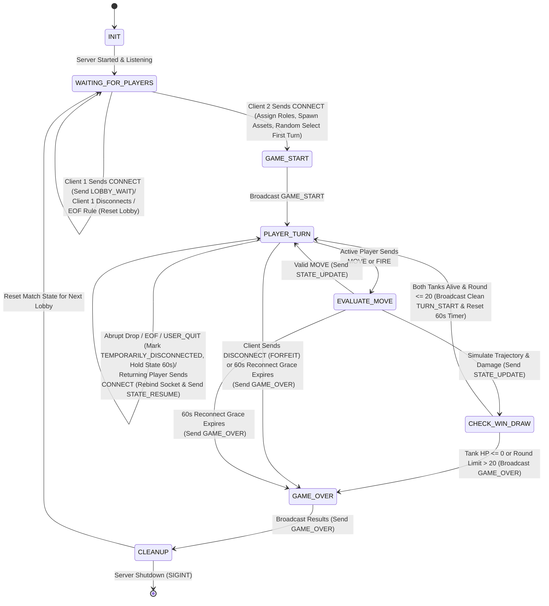

# TANKSCII : Statement of Work & Protocol Specification

**Student Name :** Ethan Sheffield  
**Date :** 2026-09-20
**Course :** CS 457 - Computer Networks  
**Target Server Domain :** `server.sheffield.edu`  

---

## 1. Game Selection & Scope (Sprint 0)

### 1.1 Game Overview
- **Chosen Game :** 
  - Tankscii : Terminal Artillery
- **Player Capacity :** 
  - 2 Players (Simulated via 2 CML Client nodes)
- **Game Summary :** 
  - Tankscii is a turn-based tactical artillery game where players take turns inputting firing angles and power levels to launch projectiles across a 2D ASCII terrain. The last surviving tank with health remaining wins the match.

### 1.2 Core Game Rules & Win/Draw Conditions
- **Turn Mechanics :** 
  - Each player has a 60-second move timer, enforced by a server-side round-robin state machine. 
  - At the start of each turn, a player can optionally move left or right by a range of 1-5 units. Next, the player inputs a forward-relative launch angle (`0°–180°`, where `0°–89°` aims forward toward the opponent for both players) and power (`1%–100%`) to fire a projectile.
  - Projectiles create a stepped crater (`-2` center drop, `-1` outer rim drop) when they land within the rendered display dimensions.
  - Damage is calculated in two categories. 
    1) Direct Hit : The projectile strikes the opponent tank directly, causing 25 hp of damage.
    2) Shrapnel Hit : If the tank is within 2 distance units of where the projectile strikes, it causes 10 hp of damage. 
  - Out-of-turn commands will be rejected by the server and if a player's time expires, the turn will pass to the next player.

- **Victory & Reconnection Conditions :** 
  1) A player wins if their opponent's health is reduced to 0HP while they maintain a health value greater than 0HP (`HP_ELIMINATION`).
  2) The opposing player explicitly forfeits (`FORFEIT`).
  3) When a player's socket drops (`ConnectionResetError`, `BrokenPipeError`, `0-byte EOF`, or `USER_QUIT`), the server marks the player `TEMPORARILY_DISCONNECTED` and preserves the match state (`board_matrix`, `tanks`, `craters`, `final_scores`, `active_turn`) for a 60-second grace period (`RECONNECT_GRACE_SECONDS = 60`). If the player reconnects within 60 seconds using their nickname/alias or player ID, both clients receive `STATE_RESUME` and the match continues seamlessly; if the 60-second grace period expires without reconnection, the surviving player wins (`DISCONNECT`).
   
- **Draw/Tie Condition :** 
  - Either both players health is reduced to 0HP in the same turn or both players have a health value greater than 0HP when a 20-round limit expires.

---

## 2. Application-Layer Messaging Protocol Blueprint

### 2.1 Message Transport & Serialization Format
- **Transport Protocol :** TCP
- **Serialization Format :** Compact UTF-8 JSON
- **Framing Mechanism :** Newline-delimited (`\n` / `0x0A`) JSON payloads
- **Receiver Buffer & Boundary Handling :** 
  - Receivers maintain a stream accumulator buffer for incoming chunks.
  - Scans for delimiter `\n` to extract complete frames and retain trailing bytes, resolving TCP stream fragmentation and coalescing.

### 2.2 Message Schema Definitions

- **Frame Header Fields :**
  - `msg_type` : Identifies the operation (`str`).
  - `player_id` : Identifies the sender (`Player_1`, `Player_2`, or `SERVER`).
  - `timestamp` : UNIX epoch timestamp (`int`).
  - `payload` : Dictionary containing message-specific parameters.

- **Message Types :**
  1. `CONNECT` (Client -> Server): Request to join or reconnect to a game room with player nickname (1–16 chars; defaults: `CobraKing` / `Thunderbolt`) and SemVer string (`client_version`).
  2. `LOBBY_WAIT` (Server -> Client): Notification to Client 1 that server is waiting for Player 2 to connect (`assigned_id: "Player_1"`).
  3. `GAME_START` (Server -> Clients): Server notifies both clients that game has started, assigns roles, spawns terrain and tanks (`Player_1` at x=10, `Player_2` at x=70, 100 HP), and designates `first_turn`.
  4. `MOVE` (Client -> Server): Active player optionally submits repositioning direction (`LEFT` or `RIGHT`) and distance (1–5 units; max 1 per turn).
  5. `FIRE` (Client -> Server): Active player submits forward-relative launch angle (0°–180°) and launch power (1%–100%).
  6. `STATE_UPDATE` (Server -> Clients): Server broadcasts updated round (1–20), action (`MOVE`, `FIRE`, `TIMEOUT`, `TURN_START`, or `PLAYER_DISCONNECTED`), tank positions/HP, trajectory coordinates, impact point, crater list, and remaining turn timer.
  7. `STATE_RESUME` (Server -> Clients): Server restores preserved board state (`tanks`, `craters`), `scores`, `round`, `active_turn`, `time_remaining`, and `move_used` to both clients when a `TEMPORARILY_DISCONNECTED` player reconnects within the 60-second grace period.
  8. `ERROR` (Server -> Client): Server notifies client of out-of-turn actions (`OUT_OF_TURN`), invalid parameters (`INVALID_PARAMS`), repeated move (`MOVE_ALREADY_USED`), full lobby (`LOBBY_FULL`), malformed frames (`MALFORMED_FRAME`), or timeout (`TIMEOUT`).
  9. `DISCONNECT` (Client -> Server): Client notifies server of intentional departure or forfeit (`FORFEIT` or `USER_QUIT`).
  10. `GAME_OVER` (Server -> Clients): Server broadcasts final outcome (winner, reason: `HP_ELIMINATION`, `ROUND_LIMIT`, `FORFEIT`, or `DISCONNECT`), final scores, and summary message.

#### Example JSON Protocol Schema:

- **Client Action (`MOVE`) :**
```json
{
  "msg_type": "MOVE",
  "player_id": "Player_1",
  "payload": {
    "direction": "RIGHT",
    "distance": 3
  },
  "timestamp": 1727000005
}
```

---

### 2.3 Game State Machine (FSM) Design (Sprint 1 Deliverable)

- **State Machine Flow :**
  - `INIT` -> `WAITING_FOR_PLAYERS` -> `GAME_START` -> `PLAYER_TURN` -> `EVALUATE_MOVE` -> `CHECK_WIN_DRAW` -> `GAME_OVER` -> `CLEANUP`.



---

## 3. Game Behavior & Server Concurrency Architecture (Sprint 2 Deliverable)

### 3.1 Server Concurrency Strategy
- **Architecture Choice :** 
  - Single-threaded non-blocking I/O multiplexing using Python's `selectors` (`selectors.DefaultSelector` / `select.select`).
  - The server registers the non-blocking listening socket (`EVENT_READ`, `data=None`) and up to 2 connected client sockets (`EVENT_READ`, `data=ClientSession`) within a single deterministic event loop, using dynamic `sel.select(timeout)` intervals to drive the 60-second turn timer (`time.monotonic()`) and the 60-second reconnection grace timer (`RECONNECT_GRACE_SECONDS = 60`).
- **Synchronization Logic :** 
  - **Event-Driven State Isolation :** Because all socket reads, frame extractions (`stream_buffer`), physics calculations, and state transitions execute sequentially on a single thread, shared resources (`fsm_state`, `clients`, `board_matrix`, `tanks`, `active_turn`, `round`, `final_scores`) are mutated atomically to completion without concurrent data races or deadlocks.
  - **Broadcast Safety & State Preservation :** Outbound broadcasts iterate over a static snapshot of `clients` (`list(clients.items())`) with per-socket `try/except (ConnectionResetError, BrokenPipeError, TimeoutError, OSError)` blocks, deferring socket unregistration (`sel.unregister`) and marking dropped players `TEMPORARILY_DISCONNECTED` until the broadcast completes.

### 3.2 State & Score Synchronization Across Clients
- **Turn Enforcement :** 
  - Before mutating state in `PLAYER_TURN`, the server verifies `player_id == active_turn`. Out-of-turn commands from the waiting client are rejected immediately with `ERROR` (`error_code: "OUT_OF_TURN"`, `retry_allowed: false`) without interrupting the active player's turn or 60-second timer.
  - Invalid move/fire parameters or duplicate moves in the same turn return `ERROR` (`"INVALID_PARAMS"` or `"MOVE_ALREADY_USED"`, `retry_allowed: true`) to the active player.
- **Score, Board & Reconnection Synchronization :** 
  - Following every valid `MOVE`, `FIRE`, or 60-second `TIMEOUT`, the server synchronously broadcasts a `STATE_UPDATE` frame to both clients containing the current `round`, `tanks` coordinates/HP, `move_path` or projectile `trajectory`/`impact`, `damage_dealt`, `craters`, `next_turn`, and `time_remaining` (followed by a clean `TURN_START` state update after `FIRE`).
  - When a `TEMPORARILY_DISCONNECTED` player reconnects within the 60-second grace period, the server attaches the new socket to their active `ClientSession` and sends `STATE_RESUME` to both clients so the match resumes seamlessly without state loss.
  - When a tank reaches `0 HP`, Round 20 concludes, a player forfeits, or the 60-second reconnection grace period expires, the server broadcasts `GAME_OVER` (`winner`, `reason`, `final_scores`) to synchronize the final leaderboard across connected clients.

---

## 4. Coding & AI Implementation Plan (Sprint 3)

- **Permitted AI Tools:** 
  - Google Antigravity
- **AI Prompting & Constraint Strategy:** 
  - I created a root `AGENTS.md` rule file alongside modular skills in `.agents/skills/` derived directly from the Sprint 1 & 2 specifications. This forces the agent to strictly obey newline-delimited JSON schemas, 8-state FSM transitions, single-threaded `selectors` concurrency model, and PEP 8 modularity rules before writing or modifying any code.
- **Implementation Risk Management:** 
  - **Verification & Quality:** Mitigate integration bugs by implementing an automated `unittest` suite, performing thorough manual code reviews, and testing multi-client gameplay and disconnect recovery locally before CML deployment.
  - **Time Management:** Work consistently across incremental milestones and aim to finish early to leave ample buffer for debugging and network verification.

---

## 5. CML Multi-Subnet Topology & Wireshark Deployment Plan (Sprint 4 & 5 Deliverable)

> For now you can use the topology below. We may update this when we get to defining subnets.

### 5.1 Subnet & Router Design
- **Subnet A (Client 1):** `192.168.10.0/24` (Interface `Gi0/1` on Router R1)
- **Subnet B (Client 2):** `192.168.11.0/24` (Interface `Gi0/2` on Router R1)
- **Subnet C (Game Server):** `192.168.20.0/24` (Interface `Gi0/1` on Router R2)
- **Router Backbone:** `10.0.0.0/30` (Interface `Gi0/0` on R1 <-> `Gi0/0` on R2)

### 5.2 DHCP Pools & DNS Configuration Plan
- **Router R1 DHCP Pool 1 (`CLIENT1_POOL`):** Leases `192.168.10.10` - `192.168.10.50`, gateway `192.168.10.1`, DNS `10.0.0.2`.
- **Router R1 DHCP Pool 2 (`CLIENT2_POOL`):** Leases `192.168.11.10` - `192.168.11.50`, gateway `192.168.11.1`, DNS `10.0.0.2`.
- **Router R2 Authoritative DNS:** Configured with `ip dns server` and static host mapping `server.[yourlastname].edu` -> `192.168.20.100`.

### 5.3 Deployment Strategy & Wireshark Trace Capture
- **CML Deployment Strategy:** Deploy `server.py` onto Subnet C node (`192.168.20.100`) behind Router R2, and `client.py` onto Subnet A and Subnet B nodes behind Router R1.
- **Cisco Infrastructure Configuration:** Router R1 DHCP pools (`CLIENT1_POOL`, `CLIENT2_POOL`) and Router R2 authoritative DNS (`ip host server.[lastname].edu 192.168.20.100`).
- **Wireshark Trace Capture Plan:** Capture DHCP DORA exchange (`dhcp_negotiation.pcap`) and DNS query/response resolution (`dns_lookup.pcap`).
