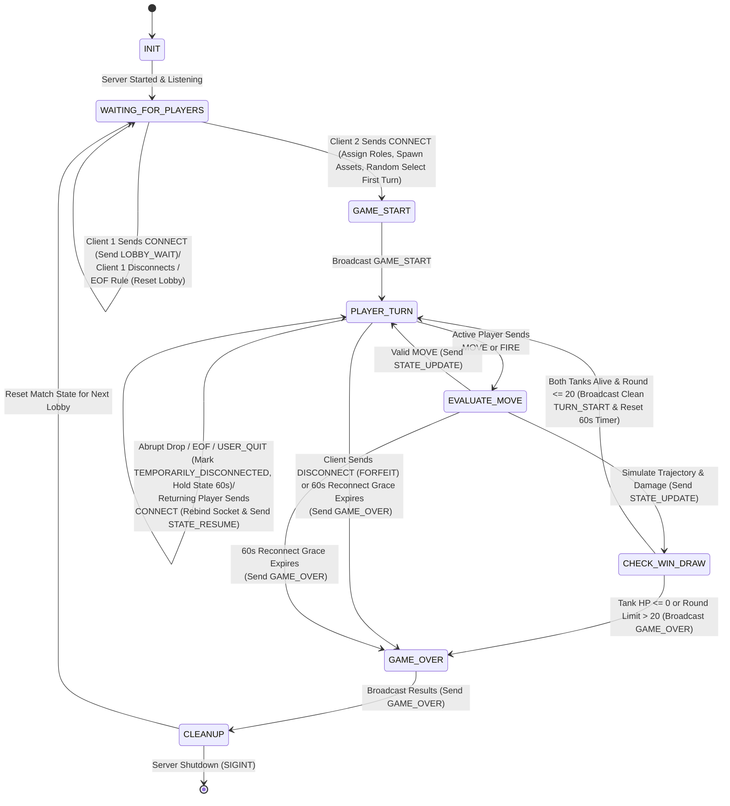

# TANKSCII : Game State Machine (FSM) Specification

**Author :** Ethan Sheffield  
**Date :** 2026-10-04  
**Course :** CS 457 - Computer Networks  
**Target Server Domain :** `server.sheffield.edu`  

---

---

## State Handling Logic & Edge Cases

### 1. Valid Moves
- **Tank Repositioning (`MOVE`) :** 
    - The active player may optionally submit one `MOVE` command per turn (`direction: "LEFT" | "RIGHT"`, `distance: 1–5`). The server validates distance limits and terrain bounds, updates tank coordinates, and broadcasts `STATE_UPDATE` (`action: "MOVE"`). The state machine loops back to `PLAYER_TURN` so the active player can aim and fire with their remaining time.
- **Projectile Launch (`FIRE`) :** 
    - The active player submits forward-relative launch values (`angle: 0–180`, `power: 1–100`, where `0–89` aims forward toward the opponent for both players). State transitions to `EVALUATE_MOVE`, where the server simulates trajectory physics, creates stepped terrain craters (`-2` center drop, `-1` outer rim drop), and deducts damage (Direct Hit: 25 HP; Shrapnel Hit within 2 units: 10 HP). The server broadcasts `STATE_UPDATE` (`action: "FIRE"`), transitions to `CHECK_WIN_DRAW`, and if the match continues, broadcasts a clean `STATE_UPDATE` (`action: "TURN_START"`, `trajectory: null`, `impact: null`) for the next player's turn.

### 2. Invalid Input & Turn Timeouts
- **Out-of-Turn Actions :** 
    - Commands from the inactive player are rejected immediately with `ERROR` (`error_code: "OUT_OF_TURN"`). The active player's turn and timer continue uninterrupted.
- **Illegal Parameters :** 
    - Out-of-bounds firing values, distance > 5, or multiple `MOVE` attempts in a single turn return `ERROR` (`error_code: "INVALID_PARAMS"` or `"MOVE_ALREADY_USED"`) with `retry_allowed: true`. The active player's turn and timer continue uninterrupted.
- **60-Second Turn Timeout :** 
    - If the countdown expires before a shot is fired, the server sends `ERROR` (`error_code: "TIMEOUT", retry_allowed: false`) to the player who did not fire. The server then broadcasts `STATE_UPDATE` (`action: "TIMEOUT", time_remaining: 60`) to hand off the turn to the opponent, and remains in `PLAYER_TURN`.
- **Full Lobby Rejection (`LOBBY_FULL`) :**
    - If a 3rd client connects while both player slots (`2/2`) are filled and connected, the server sends `ERROR` (`error_code: "LOBBY_FULL", retry_allowed: false`), unregisters and closes that socket, and leaves the active FSM state untouched.

### 3. Unexpected Client Disconnections, State Preservation & Reconnection
- **Exception Trapping :** 
    - Non-blocking socket `recv()` and `sendall()` handlers catch `ConnectionResetError` (TCP RST), `BrokenPipeError` (EPIPE during broadcast), `TimeoutError`, and `OSError` without crashing the server process.
- **0-Byte EOF Detection :** 
    - Receive handlers evaluate `if not chunk:` (`b""`) to detect TCP FIN teardowns and avoid 100% CPU infinite spin loops.
- **Lobby Drop (`WAITING_FOR_PLAYERS`) :** 
    - If Client 1 departs before Client 2 joins, the server unregisters (`sel.unregister(sock)`) and closes the socket, resetting the lobby state in `WAITING_FOR_PLAYERS`.
- **Mid-Game State Preservation & Reconnection (`PLAYER_TURN`, `EVALUATE_MOVE`) :** 
    - **Explicit Surrender (`FORFEIT`) :** A `DISCONNECT` frame with `reason: "FORFEIT"` immediately routes to `GAME_OVER`, declaring the surviving player the victor (`reason: "FORFEIT"`) and entering `CLEANUP`.
    - **State Preservation (`TEMPORARILY_DISCONNECTED`, 60s Grace Period) :** When a client socket drops abruptly (`ConnectionResetError`, `BrokenPipeError`, `0-byte EOF`) or sends `DISCONNECT` (`reason: "USER_QUIT"`) during an active match, the server does **not** immediately delete the game room. It unregisters and closes only the dropped socket, marks the player's `ClientSession.connection_status = "TEMPORARILY_DISCONNECTED"` with `disconnect_deadline = time.monotonic() + 60.0`, freezes `paused_turn_remaining`, holds all match state (`board_matrix`, `tanks`, `craters`, `final_scores`, `active_turn`, `round`, `move_used`), and notifies the connected opponent via `STATE_UPDATE` (`action: "PLAYER_DISCONNECTED"`).
    - **Re-connection Handshake & `STATE_RESUME` :** When the returning player re-runs `client.py` within 60 seconds and sends `CONNECT` with their nickname/alias or player ID, the server recognizes the returning session, attaches the new socket to their active `ClientSession`, restores `turn_deadline`, and transmits `STATE_RESUME` to both clients so the match resumes seamlessly without state loss.
    - **Grace Period Expiration :** If the 60-second grace period expires before the disconnected player reconnects, the server transitions to `GAME_OVER`, sends `GAME_OVER` (`reason: "DISCONNECT"`) to the surviving opponent, unregisters and closes all remaining sockets in `CLEANUP`, and resets match state to `WAITING_FOR_PLAYERS`.