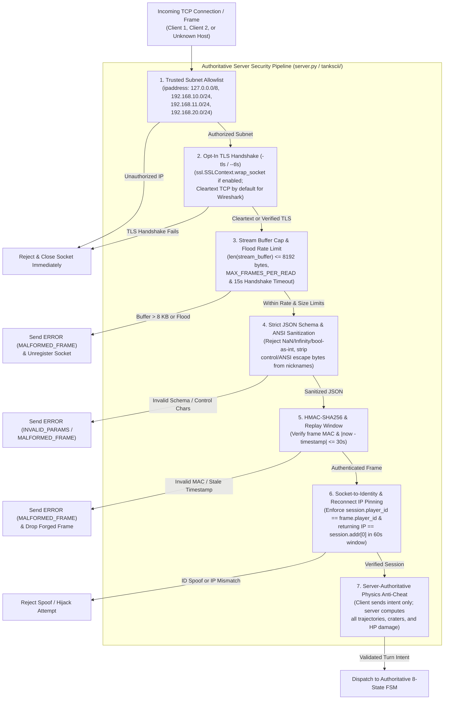

# TANKSCII : Security Protocols & Threat Mitigation Specification

**Author :** Ethan Sheffield  
**Date :** 2026-11-15  
**Course :** CS 457 - Computer Networks  
**Target Server Domain :** `server.sheffield.edu`  

---

## 1. Security Architecture Overview & Wireshark Compatibility

### 1.1 Design Philosophy :
---
- **Cleartext Default with Opt-In TLS & Defense-in-Depth :**
  - To preserve full packet-level observability in **Wireshark** by default (allowing direct inspection and annotation of newline-delimited UTF-8 JSON payloads over TCP), Tankscii implements layered application, protocol, and terminal security controls alongside an **opt-in `--tls` (`-tls`) encrypted transport mode** using **only the Python 3 standard library** (`ipaddress`, `hmac`, `hashlib`, `time`, `ssl`), paired with network-layer access control and router hardening on Cisco IOS Router `R1`.
  - Every security mechanism operates seamlessly across both the **Cisco Modeling Labs (CML) 3-subnet topology** (`192.168.10.0/24`, `192.168.11.0/24`, `192.168.20.0/24`) and **local loopback testing** (`127.0.0.1`).



### 1.2 Attack Surface & Mitigation Matrix :
---
| Attack Surface | Threat Vector / Vulnerability | Mitigation Implementation | Standard Library / Device | CML & Localhost Behavior |
| :--- | :--- | :--- | :--- | :--- |
| **1. Network Perimeter & Transport** | Unauthorized hosts connecting to `0.0.0.0:<port>` | **Trusted Subnet Allowlisting** | `ipaddress` (`server.py`) | Allows `127.0.0.0/8` (local) and `192.168.10.0/24`, `192.168.11.0/24`, `192.168.20.0/24` (CML) |
| **1. Network Perimeter & Transport** | Passive packet sniffing and active MitM eavesdropping | **Opt-In TLS Encryption (`-tls` / `--tls`)** | `ssl` (`SSLContext`) | Disabled by default for Wireshark JSON captures; enabled on demand via `-tls` |
| **1. Network Perimeter & Transport** | Direct Client-to-Client probing & privileged port sweeps | **Router `R1` Extended ACL & Hardening** | Cisco IOSv (`es-R1`) | Isolates Subnets A & B while permitting ICMP `ping`, DNS (`53`), DHCP, and Tankscii TCP |
| **2. TCP Stream & Event Loop** | Memory exhaustion DoS via unbounded streams without `\n` | **`stream_buffer` 8 KB Ceiling** | Built-in `bytearray` (`framing.py`) | Enforces `MAX_BUFFER_BYTES = 8192` per client session before `\n` (`0x0A`) |
| **2. TCP Stream & Event Loop** | Single-thread event loop starvation & idle slot holding | **Command Flood Rate Limit & 15s Timeout** | `selectors`, `time` (`server.py`) | Caps processing at `MAX_FRAMES_PER_READ = 8` and drops idle unauthenticated sockets after `15s` |
| **3. Session & Reconnection Window** | Session hijacking during the 60s `TEMPORARILY_DISCONNECTED` window | **Source-IP Reconnection Pinning** | `socket` (`session.addr[0]`) | Pins `192.168.10.2` vs. `192.168.11.2` on CML; permits `127.0.0.1` on localhost |
| **3. Session & Reconnection Window** | Cross-player command spoofing (`Player_2` claiming `"player_id": "Player_1"`) | **Socket-to-Identity Binding** | `selectors` (`ClientSession`) | Binds `session.player_id` to the TCP socket descriptor rather than trusting JSON headers |
| **4. JSON Protocol & Physics Engine** | In-transit payload tampering, command forgery, and packet replay | **HMAC-SHA256 Frame Signing & Replay Window** | `hmac`, `hashlib`, `time` | Keeps JSON cleartext for Wireshark while authenticating headers & payloads (`±30s` window) |
| **4. JSON Protocol & Physics Engine** | Python `bool`-as-`int` type confusion, `NaN`/`Infinity`, and recursion DoS | **Strict JSON Type & Depth Validation** | `json` (`protocol.py`, `framing.py`) | Explicitly checks `not isinstance(val, bool)`, rejects `NaN`/`Infinity`, and traps `RecursionError` |
| **4. JSON Protocol & Physics Engine** | Client-side teleportation, coordinate manipulation, or damage cheats | **Authoritative Physics Anti-Cheat** | `math` (`tankscii/physics.py`) | Clients transmit intent (`direction`/`distance`, `angle`/`power`); server owns all coordinates & HP |
| **5. Terminal UI Renderer** | Terminal UI hijacking and HUD spoofing via malicious nicknames | **ANSI Escape & Control-Byte Sanitization** | Printable ASCII check (`protocol.py`) | Rejects ASCII control characters (`0x00–0x1F`, `0x7F`) and `\x1b` escape sequences |

---

## 2. Attack Surface 1 : Network Perimeter & Transport Layer

### 2.1 Attack Surface Exposure :
---
- **Wildcard Socket Binding (`0.0.0.0`) :** Because `server.py` binds its listening socket to `0.0.0.0:<port>` as required by the specification, any host with a route to the server can attempt to open TCP connections or disrupt the 2-player lobby.
- **Cross-Subnet Routing & Port Exposure :** Across Router `R1`, hosts on Subnet A (`192.168.10.0/24`) and Subnet B (`192.168.11.0/24`) can route packets to each other or probe privileged ports (`< 1024`) on `es-Server` (`192.168.20.100`).
- **Cleartext Multi-Hop Transit :** Standard TCP sockets transmit UTF-8 JSON frames in plaintext across routed links where passive eavesdroppers could inspect traffic.

### 2.2 Mitigation 1 : Trusted Subnet Allowlisting (`ipaddress`)
---
- Immediately upon `listen_sock.accept()`, `register_accepted_socket()` validates `client_addr[0]` using Python's standard library `ipaddress.ip_address()` and `ipaddress.ip_network()` against `ALLOWED_SUBNETS`:

| Allowed Network CIDR | Environment Scope | Purpose |
| :--- | :--- | :--- |
| `127.0.0.0/8` | Localhost Testing | Permits local loopback testing (`127.0.0.1`) |
| `192.168.10.0/24` | CML Subnet A (`Gi0/1`) | Permits DHCP-leased `es-Client1` (`192.168.10.2`) |
| `192.168.11.0/24` | CML Subnet B (`Gi0/2`) | Permits DHCP-leased `es-Client2` (`192.168.11.2`) |
| `192.168.20.0/24` | CML Subnet C (`Gi0/3`) | Permits local diagnostics from `es-Server` (`192.168.20.100`) |

- Connections originating outside `ALLOWED_SUBNETS` are logged at `WARNING` level and closed immediately before selector registration.

### 2.3 Mitigation 2 : Opt-In Transport Layer Security (`-tls` / `--tls`)
---
- **Opt-In CLI Flag Design (`-tls` / `--tls`) :**
  - Both `server.py` and `client.py` accept an optional `-tls` / `--tls` flag so TLS never obscures Wireshark grading captures unless explicitly enabled:
    - **Default Mode (No Flag) :** Operates over standard cleartext TCP so Wireshark `.pcap` captures display raw UTF-8 JSON frames cleanly.
    - **Encrypted Mode (`-tls` / `--tls`) :** Wraps the underlying TCP sockets in TLSv1.2/TLSv1.3 encryption using Python's standard library `ssl` module (`ssl.SSLContext`).
- **CLI Invocation Examples :**
  - **Server with TLS :** `python3 server.py -p 8080 -tls`
  - **Client with TLS :** `python3 client.py -i server.sheffield.edu -p 8080 -tls`
- **Verification & Non-Blocking `selectors` Integration :**
  - **Context Initialization :** `server.py` creates `ssl.SSLContext(ssl.PROTOCOL_TLS_SERVER)` and loads a local self-signed certificate/key pair (`cert.pem` / `key.pem`) assigned to `CN=server.sheffield.edu` (with Subject Alternative Names for `server.sheffield.edu`, `192.168.20.100`, and `127.0.0.1`). `client.py` creates `ssl.SSLContext(ssl.PROTOCOL_TLS_CLIENT)` pinned to `cert.pem`.
  - **Non-Blocking Socket Wrapping (`tankscii/framing.py`) :** Because `server.py` uses non-blocking sockets (`setblocking(False)`) with `selectors.DefaultSelector`, `read_available_frames()` and `send_frame_safely()` catch `ssl.SSLWantReadError` and `ssl.SSLWantWriteError` alongside `BlockingIOError` so partial TLS records never block the single-threaded event loop.
  - **Optional Wireshark TLS Decryption (`SSLKEYLOGFILE`) :** If `SSLKEYLOGFILE` is set in the environment when `-tls` is enabled, Python's `ssl.SSLContext.keylog_filename` exports ephemeral session keys so Wireshark can decrypt and inspect the JSON frames inside a TLS capture if needed.

### 2.4 Mitigation 3 : Cisco IOS Router `R1` Extended ACL & Control-Plane Hardening
---
- Inside the Sprint 4 CML topology, Router `es-R1` enforces network-layer defense-in-depth:
  1. **Cross-Subnet Client Isolation :** Prevents `es-Client1` (`192.168.10.0/24`) and `es-Client2` (`192.168.11.0/24`) from directly probing or attacking each other's hosts.
  2. **Game Server Port Pinning :** Restricts TCP traffic entering Subnet C (`192.168.20.100`) strictly to non-privileged application ports (`1024–65535`) while blocking unauthorized management ports (`< 1024`).
  3. **Full Sprint 4 Rubric Compliance :** Explicitly permits **ICMP (`ping`)**, **DNS (`UDP/TCP 53`)**, and **DHCP (`UDP 67/68`)** so all Sprint 4 connectivity and Wireshark verification checks pass with zero packet loss.

```text
! Configure Extended ACL & Control-Plane Hardening on Router R1 (es-R1)
enable
configure terminal

! 1. Router Control-Plane Hardening
service password-encryption
no ip http server
no ip http secure-server

! 2. Extended ACL for Subnet Isolation & Server Least-Privilege
ip access-list extended TANKSCII_SUBNET_ACL
 ! Permit ICMP across all subnets for Sprint 4 zero-loss ping verification
 permit icmp any any
 ! Permit DNS queries (UDP/TCP 53) to Router R1 interfaces
 permit udp any any eq domain
 permit tcp any any eq domain
 ! Permit DHCP DORA broadcasts (UDP 67/68)
 permit udp any any eq bootps
 permit udp any any eq bootpc
 ! Permit Client 1 and Client 2 subnets to reach Game Server TCP ports (1024-65535)
 permit tcp 192.168.10.0 0.0.0.255 host 192.168.20.100 range 1024 65535
 permit tcp 192.168.11.0 0.0.0.255 host 192.168.20.100 range 1024 65535
 ! Isolate Client 1 and Client 2 from direct peer-to-peer traffic
 deny   ip 192.168.10.0 0.0.0.255 192.168.11.0 0.0.0.255
 deny   ip 192.168.11.0 0.0.0.255 192.168.10.0 0.0.0.255
 ! Block unauthorized TCP ports (e.g., Telnet/SSH/HTTP sweeps) to Game Server
 deny   tcp any host 192.168.20.100 lt 1024
 ! Permit remaining authorized return traffic
 permit ip any any
exit
```

---

## 3. Attack Surface 2 : Non-Blocking TCP Stream Framing & Event Loop Availability

### 3.1 Attack Surface Exposure :
---
- **Buffer Exhaustion DoS :** Because TCP is a byte stream and the framing engine accumulates bytes in `session.stream_buffer` (`bytearray`) until a `\n` (`0x0A`) delimiter arrives, a malicious peer could stream continuous bytes without ever sending `\n`, exhausting server memory.
- **Coalesced Command Flooding (Event Loop Starvation) :** A client could pipeline hundreds of tiny 60-byte invalid commands in a single TCP segment. Because `selectors.DefaultSelector` runs on a single thread, processing hundreds of invalid frames in one `EVENT_READ` callback could delay the active player's shot.
- **Idle Slot Holding (Slowloris) :** A peer could open a TCP connection and never transmit a `CONNECT` frame.

### 3.2 Mitigation 4 : `stream_buffer` 8 KB Ceiling (`MAX_BUFFER_BYTES = 8192`)
---
- In `tankscii/framing.py`, after appending each `recv(4096)` chunk to `session.stream_buffer`, the receiver checks `if len(session.stream_buffer) > MAX_BUFFER_BYTES:`.
- Since every valid Tankscii JSON frame is well under 2 KB, exceeding 8 KB without a newline delimiter sends `ERROR` (`error_code: "MALFORMED_FRAME"`, `retry_allowed: false`), unregisters the socket from `selectors`, and closes the connection.

### 3.3 Mitigation 5 : Per-Read Frame Rate Limiting & 15s Handshake Timeout
---
- **Per-Read Frame Cap & Error Threshold :** `service_client_socket()` caps extraction at `MAX_FRAMES_PER_READ = 8` frames per `EVENT_READ` cycle and disconnects any client that triggers more than `MAX_CONSECUTIVE_ERRORS = 15` invalid frames in a single turn.
- **Pre-Handshake Timeout (`HANDSHAKE_TIMEOUT_SECONDS = 15`) :** Sockets in `unassigned_sessions` that fail to transmit a valid `CONNECT` frame within 15 seconds of acceptance are automatically unregistered and closed.

---

## 4. Attack Surface 3 : Session Management & 60-Second Reconnection Grace Window

### 4.1 Attack Surface Exposure :
---
- **Grace Period Session Hijacking :** When a client socket drops during an active match (`ConnectionResetError`, `BrokenPipeError`, or `0-byte EOF`), the server marks that player `TEMPORARILY_DISCONNECTED` and holds the room for `RECONNECT_GRACE_SECONDS = 60`. Without IP verification, the opposing player on Subnet B (`192.168.11.2`) could open a second terminal, submit `CONNECT {"nickname": "CobraKing"}`, and hijack Player 1's (`192.168.10.2`) tank.
- **Cross-Player Header Spoofing :** Every JSON frame header contains `"player_id": "Player_1" | "Player_2"`. If the server trusted the JSON `"player_id"` string sent by the client rather than the authenticated TCP socket descriptor, `Player_2` could transmit `{"msg_type": "FIRE", "player_id": "Player_1", ...}` during `Player_1`'s turn to waste `Player_1`'s shot.

### 4.2 Mitigation 6 : Source-IP Reconnection Pinning (`session.addr[0]`)
---
- During `_handle_reconnect_handshake()` in `server.py`, the server compares the incoming socket's IPv4 address (`reconnecting_session.addr[0]`) against the disconnected session's recorded IPv4 address (`disconnected_session.addr[0]`).
- **CML Multi-Subnet Enforcement :** Because `es-Client1` resides on Subnet A (`192.168.10.2/24`) and `es-Client2` resides on Subnet B (`192.168.11.2/24`), any cross-subnet impersonation attempt fails the `reconnecting_ip == original_ip` check and is rejected immediately with `ERROR` (`error_code: "LOBBY_FULL"`, `retry_allowed: false`).
- **Localhost Compatibility :** During local testing on a single machine, both clients originate from `127.0.0.1`, allowing seamless local disconnect/reconnect testing without extra configuration flags.

### 4.3 Mitigation 7 : Socket-to-Identity Binding (`player_id` Anti-Spoofing)
---
- Upon completing the `CONNECT` handshake, `server.py` binds the assigned role (`"Player_1"` or `"Player_2"`) directly to the socket's `ClientSession.player_id` attribute registered in `selectors`.
- On every subsequent `MOVE`, `FIRE`, or `DISCONNECT` frame, the server resolves the sender identity strictly from `session.player_id` (the kernel-authenticated TCP connection) and rejects any frame whose header `"player_id"` does not match `session.player_id`.

---

## 5. Attack Surface 4 : Application Protocol Parser & Authoritative Physics Engine

### 5.1 Attack Surface Exposure :
---
- **In-Transit Payload Tampering & Replay :** Plaintext JSON frames transmitted across multiple routed hops can be modified in transit (e.g., altering `FIRE` angle/power) or captured and replayed out of sequence.
- **JSON Type Confusion & Deep Recursion :** In Python's type hierarchy, `bool` is a subclass of `int` (`isinstance(True, int) == True` and `True == 1`), and standard `json.loads()` accepts `NaN` and `Infinity` literals and up to 1000 levels of nested JSON arrays/dicts, which can corrupt ballistic physics math or trigger `RecursionError`.
- **Client-Side State Manipulation :** In peer-to-peer or client-trusted games, a modified client binary can teleport its tank, falsify projectile impact coordinates, or claim a `25 HP` direct hit on every turn.

### 5.2 Mitigation 8 : Cleartext HMAC-SHA256 Frame Authentication & Replay Window
---
- **HMAC-SHA256 Integrity (`hmac` + `hashlib`) :** Each frame envelope can carry an authentication tag computed over the canonicalized header and payload (`msg_type`, `player_id`, `timestamp`, and compact JSON `payload`) using `hmac.new(secret, canonical_bytes, hashlib.sha256).hexdigest()` and verified via constant-time `hmac.compare_digest()`. The key is read from the `TANKSCII_HMAC_SECRET` environment variable for out-of-band secrecy on CML, falling back to `DEFAULT_HMAC_SECRET` when unset for zero-config local testing.
- **Timestamp Replay Window (`MAX_CLOCK_SKEW_SECONDS = 30`) :** The validator verifies `abs(int(time.time()) - frame["timestamp"]) <= 30`, rejecting captured frames replayed after the turn has passed.
- **Wireshark Transparency :** Unlike TLS—which encrypts the entire TCP stream into opaque `Application Data` records—HMAC-SHA256 leaves `msg_type`, `player_id`, `timestamp`, and `payload` in **human-readable UTF-8 JSON** inside Wireshark packet captures.

#### Authenticated Frame Wire Example (Readable in Wireshark):
```json
{
  "msg_type": "FIRE",
  "player_id": "Player_1",
  "timestamp": 1727000008,
  "hmac": "a94f3c8b2e107d65c4a8f19283746550d1e2f3a4b5c6d7e8f90123456789abcd",
  "payload": {
    "angle": 45,
    "power": 75
  }
}
```

### 5.3 Mitigation 9 : Strict JSON Type & Numerical Boundary Validation
---
- All integer validators in `tankscii/protocol.py` (`_is_strict_int`) evaluate `isinstance(value, int) and not isinstance(value, bool)` alongside strict range bounds (`distance: 1–5`, `angle: 0–180`, `power: 1–100`, `0 <= x < 80`).
- `decode_json_line()` in `tankscii/framing.py` rejects `NaN`, `Infinity`, and `-Infinity` constants via `parse_constant` and traps `RecursionError` as `FrameDecodeError` (`"MALFORMED_FRAME"`).

### 5.4 Mitigation 10 : Server-Authoritative Physics & Anti-Cheat Isolation
---
- Tankscii enforces a **strictly server-authoritative model**: clients can only submit high-level intent (`MOVE` with `direction` and `distance: 1–5`; `FIRE` with `angle: 0–180` and `power: 1–100`).
- The server owns `terrain_heights`, `tanks`, `craters`, `move_used`, and `turn_deadline`, computing all ballistic trajectories (`simulate_ballistic_trajectory`), stepped crater deformations, and HP deductions (`25 HP` direct / `10 HP` shrapnel) internally before broadcasting read-only `STATE_UPDATE` snapshots to the thin-client renderers.

---

## 6. Attack Surface 5 : Terminal UI Renderer (`80x24` ASCII Display)

### 6.1 Attack Surface Exposure :
---
- **ANSI Escape Sequence & Control-Character Injection :** Because `client.py` enables virtual terminal ANSI processing (`enable_ansi_terminal_colors()`) and renders the opponent's `nickname` directly inside the HUD header (`format_hud_header`) and action summaries (`format_action_summary`), a malicious client could submit a nickname containing raw ANSI escape codes (e.g., `\x1b[2J` to clear the opponent's screen, `\x1b[2K\r` to overwrite the scoreboard HP bar, or `\x07` terminal bell spam).

### 6.2 Mitigation 11 : Printable ASCII Nickname Sanitization
---
- In `validate_connect_payload()` (`tankscii/protocol.py`), every character `ch` in `nickname` must satisfy `32 <= ord(ch) <= 126` (printable ASCII only), explicitly rejecting ASCII control characters (`0x00–0x1F`, including `\x1b` ESC, `\r`, `\n`, `\b`) and `0x7F` (DEL) with `ERROR` (`error_code: "INVALID_PARAMS"`, `retry_allowed: true`).
