```mermaid
sequenceDiagram
    autonumber
    participant P1 as Player 1 (Active Client)
    participant S as Authoritative Server (selectors Loop)
    participant P2 as Player 2 (Waiting Client)

    Note over P1,P2: Server in [PLAYER_TURN] (active_turn = "Player_1", move_used = False, 30s turn clock running)

    rect rgb(45, 55, 72)
    Note over P1,P2: Phase 1 : Move Request, Turn Enforcement & Legality Validation (MOVE)
    alt Out-of-Turn Move Attempt (Waiting Client Sends Command)
        P2->>S: MOVE {"direction": "LEFT", "distance": 2}\n
        Note over S: Selector wakes on P2 EVENT_READ<br/>Turn Check Fails: sender ("Player_2") != active_turn ("Player_1")<br/>State unchanged and Player_1 turn clock continues uninterrupted
        S->>P2: ERROR {"error_code": "OUT_OF_TURN", "retry_allowed": false}\n
    else Invalid Move Parameters or Duplicate Move (distance > 5, Out of Bounds, or move_used == True)
        P1->>S: MOVE {"direction": "RIGHT", "distance": 9}\n
        Note over S: Selector wakes on P1 EVENT_READ<br/>Turn Check Passes: sender == "Player_1"<br/>Legality Check Fails: distance (9) > max (5) or move_used == True<br/>State unchanged and Player_1 retains turn & remaining clock
        S->>P1: ERROR {"error_code": "INVALID_PARAMS", "retry_allowed": true}\n
    else Valid Move Request (player_id == active_turn, move_used == False, 1 <= distance <= 5)
        P1->>S: MOVE {"direction": "RIGHT", "distance": 3}\n
        Note over S: Selector wakes on P1 EVENT_READ<br/>FSM: [PLAYER_TURN] -> [EVALUATE_MOVE]<br/>Validates active_turn == "Player_1", terrain bounds, & move_used == False<br/>Mutates State: Player_1 x (10 -> 13), move_used = True
        par Synchronous Broadcast of STATE_UPDATE to All Connected Clients
            S->>P1: STATE_UPDATE (action="MOVE", tanks={P1: x=13, P2: x=70}, next_turn="Player_1", time_remaining=24)\n
        and
            S->>P2: STATE_UPDATE (action="MOVE", tanks={P1: x=13, P2: x=70}, next_turn="Player_1", time_remaining=24)\n
        end
        Note over P1,P2: Both clients synchronize tank positions, HUD scoreboard (100 HP vs 100 HP), and 24s timer
        Note over S: FSM: [EVALUATE_MOVE] -> [PLAYER_TURN] (Player_1 retains turn control to FIRE)
    end
    end

    rect rgb(55, 40, 75)
    Note over P1,P2: Phase 2 : Ballistic Launch Validation, State Mutation, Broadcast & Score Synchronization (FIRE)
    alt Out-of-Turn Fire Attempt (Waiting Client Sends FIRE)
        P2->>S: FIRE {"angle": 60, "power": 80}\n
        Note over S: Turn Check Fails: sender ("Player_2") != active_turn ("Player_1")
        S->>P2: ERROR {"error_code": "OUT_OF_TURN", "retry_allowed": false}\n
    else Invalid Fire Parameters (angle not in 0..180 or power not in 1..100)
        P1->>S: FIRE {"angle": 220, "power": 75}\n
        Note over S: Legality Check Fails: angle (220) outside valid range 0..180
        S->>P1: ERROR {"error_code": "INVALID_PARAMS", "retry_allowed": true}\n
    else Valid Fire Request (player_id == active_turn, 0 <= angle <= 180, 1 <= power <= 100)
        P1->>S: FIRE {"angle": 45, "power": 75}\n
        Note over S: Selector wakes on P1 EVENT_READ<br/>FSM: [PLAYER_TURN] -> [EVALUATE_MOVE]<br/>Simulates ballistic trajectory, records terrain crater, computes 25 HP Direct Hit<br/>Mutates State: Player_2 HP (100 -> 75), updates round/score tallies<br/>FSM: [EVALUATE_MOVE] -> [CHECK_WIN_DRAW]
        alt Both Tanks HP > 0 and Round <= 20 (Match Continues & Turn Switches)
            par Synchronous Broadcast of STATE_UPDATE & Score Synchronization
                S->>P1: STATE_UPDATE (action="FIRE", damage_dealt=25, tanks={P1: 100HP, P2: 75HP}, next_turn="Player_2", time_remaining=30)\n
            and
                S->>P2: STATE_UPDATE (action="FIRE", damage_dealt=25, tanks={P1: 100HP, P2: 75HP}, next_turn="Player_2", time_remaining=30)\n
            end
            Note over P1,P2: Clients render projectile arc, crater, updated HP scoreboard (P1: 100 HP, P2: 75 HP), and switch turn to Player_2
            Note over S: FSM: [CHECK_WIN_DRAW] -> [PLAYER_TURN]<br/>Mutates Turn State: active_turn = "Player_2", move_used = False, resets 30s turn_deadline
        else Tank HP <= 0 or Round > 20 (Match Termination & Final Leaderboard Sync)
            par Synchronous Final STATE_UPDATE Broadcast
                S->>P1: STATE_UPDATE (action="FIRE", damage_dealt=25, tanks={P1: 100HP, P2: 0HP}, next_turn="Player_2", time_remaining=30)\n
            and
                S->>P2: STATE_UPDATE (action="FIRE", damage_dealt=25, tanks={P1: 100HP, P2: 0HP}, next_turn="Player_2", time_remaining=30)\n
            end
            Note over S: FSM: [CHECK_WIN_DRAW] -> [GAME_OVER] -> [CLEANUP]
            par Synchronous Final Score / Leaderboard Broadcast (GAME_OVER)
                S->>P1: GAME_OVER (winner="Player_1", reason="HP_ELIMINATION", final_scores={P1_hp: 100, P2_hp: 0, rounds: 5})\n
            and
                S->>P2: GAME_OVER (winner="Player_1", reason="HP_ELIMINATION", final_scores={P1_hp: 100, P2_hp: 0, rounds: 5})\n
            end
            Note over P1,P2: Both clients display final match leaderboard and close connections cleanly
        end
    else 30-Second Turn Clock Expires Before FIRE (Turn Timeout)
        Note over S: sel.select(timeout) expires (monotonic clock >= turn_deadline)<br/>Mutates Turn State: active_turn = "Player_2", move_used = False, resets 30s turn_deadline
        S->>P1: ERROR {"error_code": "TIMEOUT", "retry_allowed": false}\n
        par Synchronous Broadcast of Timeout Turn Handoff
            S->>P1: STATE_UPDATE (action="TIMEOUT", actor_id="Player_1", next_turn="Player_2", time_remaining=30)\n
        and
            S->>P2: STATE_UPDATE (action="TIMEOUT", actor_id="Player_1", next_turn="Player_2", time_remaining=30)\n
        end
    end
    end
```

# TANKSCII : Move Validation, Turn Enforcement & State Broadcast Flow

**Author :** Ethan Sheffield  
**Date :** 2026-10-18  
**Course :** CS 457 - Computer Networks  
**Target Server Domain :** `server.sheffield.edu`  

---

---

## 1. Complete Round-Trip Message Flow

### 1.1 Turn Enforcement & Move Legality Validation (`ERROR` Branching)
---
- **Active Turn Check (`OUT_OF_TURN`) :** 
  - The server compares `player_id` against `active_turn`. Commands sent by the waiting client (`Player_2`) are rejected immediately with `ERROR` (`error_code: "OUT_OF_TURN"`, `retry_allowed: false`) without mutating state or interrupting `Player_1`'s 30-second turn clock.
- **Move & Firing Legality (`INVALID_PARAMS` / `MOVE_ALREADY_USED`) :**
  - **`MOVE` Validation :** 
    - Requires `move_used == False`, `direction in ("LEFT", "RIGHT")`, `1 <= distance <= 5`, and target `x` within `0..79`. Violations return `ERROR` (`"MOVE_ALREADY_USED"` or `"INVALID_PARAMS"`, `retry_allowed: true`) to the active player without advancing the turn.
  - **`FIRE` Validation :** 
    - Requires `0 <= angle <= 180` and `1 <= power <= 100`. Out-of-range values return `ERROR` (`"INVALID_PARAMS"`, `retry_allowed: true`) to the active player.

### 1.2 State Mutation & Mid-Turn `MOVE` Broadcast
---
- **Move Evaluation (`PLAYER_TURN` -> `EVALUATE_MOVE`) :** 
  - On a valid `MOVE`, the server updates `tanks["Player_1"]["x"]`, records `move_path`, sets `move_used = True`, and computes `time_remaining` from `turn_deadline`.
- **Synchronous Broadcast (`EVALUATE_MOVE` -> `PLAYER_TURN`) :** 
  - The server synchronously sends `STATE_UPDATE` (`action: "MOVE"`, `next_turn: "Player_1"`, `time_remaining`) to both `Player_1` and `Player_2`. Both clients redraw tank positions and HUD timers while `Player_1` retains turn control to `FIRE`.

### 1.3 Ballistic Simulation, `STATE_UPDATE` Broadcast & Score Synchronization
---
- **Physics & HP Evaluation (`PLAYER_TURN` -> `EVALUATE_MOVE`) :**
  - On a valid `FIRE`, the server simulates the projectile `trajectory` across `board_matrix`, records terrain `craters`, and deducts opponent HP (**25 HP** direct hit; **10 HP** shrapnel hit within 2 units).
- **Win/Draw Evaluation & Turn Switch (`EVALUATE_MOVE` -> `CHECK_WIN_DRAW`) :**
  - **Match Continues (`HP > 0` and `round <= 20`) :** 
    - The server synchronously broadcasts `STATE_UPDATE` (`action: "FIRE"`, `damage_dealt`, updated `tanks` HP, `next_turn: "Player_2"`, `time_remaining: 30`) to both clients to synchronize live scores, switches `active_turn = "Player_2"`, resets `move_used = False` and the 30s clock, and returns to `PLAYER_TURN`.
  - **Match Ended (`HP <= 0` or `round > 20`) :** 
    - The server broadcasts the final `STATE_UPDATE` frame followed immediately by `GAME_OVER` (`winner`, `reason`, `final_scores`) to synchronize the final leaderboard on both clients before entering `CLEANUP`.
  - **30-Second Turn Timeout (`TIMEOUT`) :** 
    - If `turn_deadline` expires before `FIRE`, the server sends `ERROR` (`"TIMEOUT"`, `retry_allowed: false`) to the active player and broadcasts `STATE_UPDATE` (`action: "TIMEOUT"`, `next_turn: "Player_2"`, `time_remaining: 30`) to hand off the turn.
